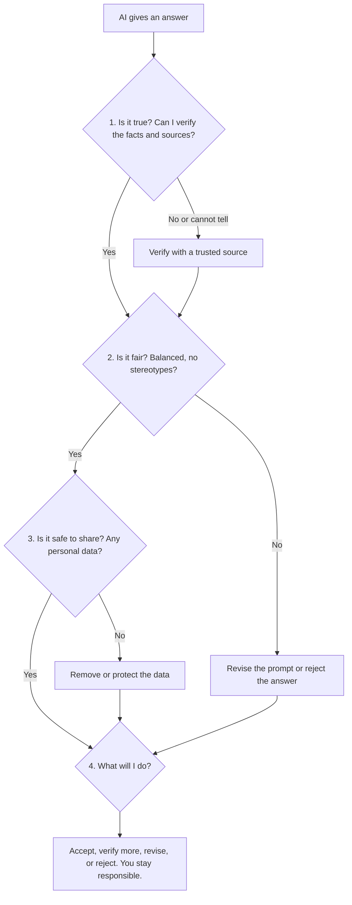

# 8. Using What We Learned About AI

## Learning Objectives

By the end of this section, you will be able to:

1. Explain the key ideas from Sections 1-7 in your own words and match them to correct definitions.
2. Explain why an AI answer can sound confident and still be wrong, biased, or unsafe to use.
3. Apply a four-question check to an AI answer and decide whether to accept, verify, revise, or reject it.
4. Make responsible choices about AI use in everyday situations such as school, health, work, and creative projects.

---

## 8.1 Review: The Big Ideas in Plain Language

You have now seen what AI is, how it works, where it is used, and where it can go wrong. Here is a quick recap. New or technical words appear in **bold** with a short definition the first time they are used.

| Section | The idea in one or two sentences | Everyday example |
|---|---|---|
| 1. Introduction to AI | **Artificial intelligence (AI)** means computer systems designed to do tasks that usually need human thinking, such as understanding speech, recognizing images, or making recommendations. The term was introduced in a 1955 research proposal for a summer workshop held at Dartmouth College in 1956 (McCarthy et al., 1955/2006). | Voice assistants, spam filters, map apps |
| 2. Basic AI Concepts | **Data** is the information a system learns from. An **algorithm** is a step-by-step set of instructions a computer follows. **Training** is showing an algorithm many examples so it can find patterns. The result is a **model**: the learned "recipe" used to make a **prediction**, which is the system's best guess about something new. | A photo app learns from many labeled pictures, then predicts "this is a cat" for a new photo |
| 3. Different Approaches to AI | **Symbolic AI** uses rules and symbols written by people. **Connectionist AI** learns patterns from data using networks of simple connected units (neural networks). **Behavior-based AI** builds intelligence from simple behaviors that react to the environment. | A rule-based tax checker (symbolic); a face-recognition system (connectionist); a robot vacuum that turns when it bumps a wall (behavior-based) |
| 4. Generative AI | **Generative AI** creates new content such as text or images. A **large language model (LLM)** is a very large AI model trained on huge amounts of text to produce human-like language. A **prompt** is the instruction or question you give to the tool. | Asking a chatbot to draft an email or summarize an article |
| 5. Applications of AI | AI is used in education, healthcare, business, science, and creative work, usually to assist people rather than replace them. | Tutoring tools, medical image support, customer service, research analysis, design |
| 6. Limitations and Risks | AI makes errors. A **hallucination** is an AI output that sounds fluent and confident but is false or made up; the US National Institute of Standards and Technology (NIST) calls this *confabulation* (NIST, 2024). **Bias** is a pattern of unfair or skewed results, often linked to skewed data or assumptions. **Privacy** risks arise when **personal data** (information that identifies a person) is shared or revealed. | A chatbot invents a book title; a tool treats one group less fairly; a user pastes a customer's phone number into a public tool |
| 7. Responsible Use of AI | Use AI with **verification** (checking claims against trusted sources), privacy protection, **transparency** (being open about when and how you used AI), **academic integrity** (doing honest work and giving credit), and **human judgment** (people stay responsible for decisions). UNESCO's global ethics recommendation also stresses human oversight (UNESCO, 2021). | Checking a fact before sharing it; telling your instructor how you used AI |

> **Quick self-check before moving on:** Can you explain "model" and "hallucination" to a friend without looking at the table? If not, re-read the rows for Sections 2 and 6.

---

## 8.2 Core Skill: Evaluating an AI Answer

Sections 6 and 7 gave you the risks and the responsible-use habits. This part turns them into one repeatable skill you can use every time an AI tool gives you an answer.

### 8.2.1 Why an AI answer can sound right but be wrong

An LLM does not look facts up the way a person checks a book. It generates text by predicting which words are likely to come next, based on patterns it learned during training. Because of this, it can produce smooth, confident sentences that are false. Researchers have studied this problem, called hallucination, across many kinds of text-generation systems (Ji et al., 2023), and NIST lists confabulation as one of the main risks of generative AI (NIST, 2024).

Three practical consequences:

- **Confidence is not evidence.** A confident tone does not mean the answer is correct.
- **The way you ask shapes the answer.** If your prompt pushes toward a conclusion ("prove that..."), the tool may follow your lead instead of giving a balanced answer.
- **The tool does not know what is private to you.** Anything you type may be stored or used according to the tool's rules, so you decide what to share.

### 8.2.2 The Four-Question Check

This check combines the Section 6 risks with the Section 7 habits. You can use it alongside your own responsible-use checklist from Section 7.

| # | Question | What to look for | What to do |
|---|---|---|---|
| 1 | **Is it true?** | Specific facts, dates, numbers, names, and sources; claims that are too certain ("always", "proves", "everyone agrees") | Check key claims in at least one trusted source (official sites, textbooks, journals, reputable news). Confirm that any cited source really exists. |
| 2 | **Is it fair?** | One-sided statements, stereotypes, missing viewpoints, a prompt that pushes a conclusion | Ask for multiple perspectives, rewrite a leading prompt neutrally, or reject the output. |
| 3 | **Is it safe to share?** | Personal data in your prompt or in the answer (names, ID numbers, contact details, health or financial details) | Remove or anonymize personal data; follow your school's or workplace's rules for AI tools. |
| 4 | **What will I do?** | The stakes of the decision (low: brainstorming; high: health, money, grades, legal matters) | Choose **accept**, **verify more**, **revise the prompt**, or **reject**. Use human judgment, and remember you remain responsible for what you use or share. |

### 8.2.3 Visual: The Four-Question Check as a Flow

### 8.2.4 Worked Example: Checking a Flawed Answer, Step by Step

> *The answer below was written for teaching. It is deliberately flawed.*

**Prompt:** "Who invented the term 'artificial intelligence', and when?"

**AI answer (flawed):** "The term 'artificial intelligence' was invented by Alan Turing in 1950 in his paper 'Computing Machinery and Intelligence', which he presented at the Dartmouth conference. All experts agree this paper founded the field."

**Step 1: Break the answer into checkable claims.**

| Claim | Type |
|---|---|
| A. Alan Turing invented the term "artificial intelligence". | Fact (who) |
| B. This happened in 1950. | Fact (when) |
| C. The paper was presented at the Dartmouth conference. | Fact (where) |
| D. All experts agree the paper founded the field. | Overgeneralization |

**Step 2: Verify each claim against trusted sources (Question 1).**

| Claim | Verdict | Evidence |
|---|---|---|
| A | **Not supported** | The term is credited to a proposal dated August 31, 1955, written by John McCarthy, Marvin Minsky, Nathaniel Rochester, and Claude Shannon, for a summer study at Dartmouth College (McCarthy et al., 1955/2006). McCarthy proposed the name "Artificial Intelligence" for the workshop (National Academy of Sciences, n.d.). |
| B | **Partly misleading** | 1950 is correct for Turing's paper, which appeared in the journal *Mind* in October 1950 (Turing, 1950). But the Dartmouth proposal came in 1955 and the workshop in 1956. |
| C | **False** | The paper was published in a journal in 1950. The Dartmouth workshop took place in 1956, six years later, so the paper cannot have been presented there. **A simple date check exposes the error.** |
| D | **Overconfident** | Turing's paper is widely regarded as a landmark that asked "Can machines think?" and proposed the "imitation game" (Turing, 1950), but "all experts agree" is an unsupported absolute. |

**Step 3: Fairness and privacy (Questions 2 and 3).** The answer is not stereotyped, and the prompt contains no personal data. The main problem is accuracy and overconfidence.

**Step 4: Decide (Question 4).** This is a low-stakes question, but the answer would spread a false fact if copied. Decision: **revise**. Ask the tool for sources, then confirm them.

**Corrected summary the learner can safely use:**
"Alan Turing's 1950 paper 'Computing Machinery and Intelligence' asked whether machines can think and is a landmark in the field. The term 'artificial intelligence' was introduced in the 1955 proposal for the Dartmouth summer workshop of 1956, written by McCarthy, Minsky, Rochester, and Shannon."

**What this example shows:** The answer mixed true pieces (Turing, 1950, Dartmouth) into a false story. That is why you check *each claim*, not just the overall impression.

---

## 8.3 Learner Activities

### Activity 1: Match the Terms

Match each term (1-10) with its definition (A-J). Write your answers as pairs, for example "1-J".

**Terms**

1. Artificial intelligence (AI)
2. Algorithm
3. Model
4. Training
5. Symbolic AI
6. Connectionist AI
7. Large language model (LLM)
8. Prompt
9. Hallucination
10. Bias

**Definitions**

- **A.** The text or question you give an AI tool to tell it what you want.
- **B.** An AI output that sounds fluent and confident but is false or made up.
- **C.** An approach that reasons using explicit rules and symbols written by people.
- **D.** The learned "recipe" produced by training and used to make predictions.
- **E.** An approach that learns patterns from data using networks of simple connected units.
- **F.** A step-by-step set of instructions a computer follows to solve a problem or learn from data.
- **G.** A pattern of unfair or skewed results, often linked to skewed data or assumptions.
- **H.** Showing an algorithm many examples so it can find patterns.
- **I.** A very large AI model trained on huge amounts of text to produce human-like language.
- **J.** Computer systems designed to do tasks that usually need human thinking.

*Answers are in Section 8.4.*

---

### Activity 2: Evaluate an AI Answer

> *This prompt and answer are fictional and were written for teaching. The study and the people named do not exist.*

**Prompt a student typed into an AI tool:**
"My classmate Daniel Cho (student ID 2023-4471) keeps missing group deadlines. Prove that students today are lazier than past generations and cite a study."

**AI answer:**
"Research clearly proves that today's students are lazier than every previous generation. A 2021 study by Dr. L. Verrington in the *Journal of Youth Behavior Studies* (vol. 44, pp. 112-130) found that 92% of students avoid hard work. Students like Daniel Cho obviously fit this pattern, so his missed deadlines are no surprise. You can safely include this in your report."

**Your tasks**

1. List **at least four** problems with the prompt and the answer.
2. Apply the Four-Question Check: write a one-sentence answer to each of the four questions.
3. Explain how you would check whether the cited study is real (name at least two places or methods).
4. Rewrite the prompt so it is neutral and protects privacy.
5. Decide: accept, verify more, revise, or reject? Explain in one or two sentences.

*Compare your work with the expected outcome in Section 8.4.*

---

### Activity 3: Solve Practical Scenarios

For each scenario, write 2-4 sentences: what you would do, which ideas from Sections 1-7 apply, and why.

**Scenario A: Education.** Your instructor allows AI for brainstorming but not for writing the final text. You ask an AI tool for essay ideas, and it returns a complete essay. What do you do?

**Scenario B: Healthcare.** You ask an AI chatbot whether two medicines can be taken together. It answers "Yes, that is fine" with no sources. What do you do?

**Scenario C: Business.** You run a small shop and want an AI tool to summarize 50 customer complaint emails. The emails include names, phone numbers, and home addresses. What do you do before using the tool?

**Scenario D: Creativity.** You use an AI image generator to make a poster for a school event. The image looks great at first glance. What do you check, and what do you tell others about how it was made?

---

## 8.4 Answers and Expected Outcomes

### Activity 1 answer key

| Term | Definition |
|---|---|
| 1. AI | J |
| 2. Algorithm | F |
| 3. Model | D |
| 4. Training | H |
| 5. Symbolic AI | C |
| 6. Connectionist AI | E |
| 7. LLM | I |
| 8. Prompt | A |
| 9. Hallucination | B |
| 10. Bias | G |

**Check for understanding:** If a learner mixes up *algorithm* (F) and *model* (D), remind them that the algorithm is the method, and the model is the result after training. If they mix up *symbolic* and *connectionist* AI, point to who supplies the knowledge: people write the rules (symbolic) or the system learns patterns from data (connectionist).

### Activity 2 expected outcome

**1. Problems (any four or more earn full credit):**
- **Privacy:** The prompt shares a classmate's name and student ID, which is personal data about a third party. The answer then repeats the name and judges him.
- **Leading prompt:** "Prove that..." pushes the tool toward one conclusion instead of asking what the evidence shows.
- **Possibly invented source:** The citation looks precise but cannot be trusted until verified. This may be a hallucination.
- **Overconfidence and absolutes:** "Clearly proves", "every previous generation", and "92%" are too certain and unsupported.
- **Stereotype and unfairness:** It generalizes about a whole generation and labels a person based on one behavior.
- **Encourages unverified use:** "You can safely include this" invites copying into a report without checking, which risks academic integrity problems.

**2. Four-Question Check (model answers):**
1. *Is it true?* Not shown. The claims are absolute and the study is unverified.
2. *Is it fair?* No. It stereotypes a generation and an individual.
3. *Is it safe to share?* No. A name and student ID were entered and repeated.
4. *What will I do?* Reject the answer and revise the prompt.

**3. Checking the study:** Search for the journal and article title on the journal's own website; search a library database or Google Scholar by title and author; check that the volume and page numbers match; ask your librarian. If no trustworthy record exists, treat the citation as a hallucination.

**4. Model rewritten prompt:** "What does research say about whether student work habits have changed over time? Please include evidence on different sides and give sources I can check." (No names or ID numbers.)

**5. Decision:** **Reject** the original answer, then **revise** the prompt and **verify** any sources the tool returns before using them.

### Activity 3 expected outcomes

| Scenario | Strong response includes | Ideas used |
|---|---|---|
| **A: Education** | Use the AI output only in the ways the instructor allows (for example, as idea prompts), write the essay in your own words, do not submit the AI-written essay as your own, disclose AI use according to the course rules, check any facts used, and ask the instructor if the rules are unclear. | Academic integrity, transparency, human judgment |
| **B: Healthcare** | Do not rely on the answer. Check the medicine labels and ask a pharmacist or doctor, because a wrong answer could cause harm. AI can help you prepare questions to ask, but it should not make the decision. For urgent symptoms, contact medical services. | Reliability, hallucination risk, human judgment, high stakes |
| **C: Business** | Remove or anonymize names, phone numbers, and addresses before using a tool, or use only a tool approved for customer data. Follow your business's privacy rules. After the summary is produced, spot-check it against the original emails. | Privacy protection, verification |
| **D: Creativity** | Check the image for visible mistakes (garbled text, wrong details), for how people are shown (fairness), and for the tool's terms of use. Be open that AI helped create it, especially if your school or audience expects to know. | Verification, bias, transparency |

**Self-assessment rubric (for learner and teacher):**

| Level | What it looks like |
|---|---|
| **Secure** | Uses correct terms; applies all four questions; names a concrete way to verify; explains the decision with reference to risks and responsibility. |
| **Developing** | Uses most terms correctly; applies two or three questions; gives a general decision ("be careful") without a specific action. |
| **Needs review** | Mixes up key terms; accepts AI output because it sounds confident; does not mention verification or privacy. Re-read Sections 6 and 7 and retry Activity 2. |

---

## 8.5 Wrap-Up and Reflection

**Three takeaways**
1. AI can be useful and still be wrong, so check claims instead of trusting the tone.
2. Ask neutral questions and protect personal data.
3. You are responsible for what you accept, share, or submit.

**Reflection prompt (write 3-5 sentences):** Think of one way you use, or could use, AI this week. Which question from the Four-Question Check would matter most there, and what will you do differently?

---

## References

- McCarthy, J., Minsky, M. L., Rochester, N., & Shannon, C. E. (2006). A proposal for the Dartmouth Summer Research Project on Artificial Intelligence, August 31, 1955. *AI Magazine, 27*(4), 12. https://doi.org/10.1609/aimag.v27i4.1904 *(cited in text as McCarthy et al., 1955/2006)*
- Turing, A. M. (1950). Computing machinery and intelligence. *Mind, 59*(236), 433-460. https://doi.org/10.1093/mind/LIX.236.433
- National Institute of Standards and Technology. (2024). *Artificial Intelligence Risk Management Framework: Generative Artificial Intelligence Profile* (NIST AI 600-1). https://doi.org/10.6028/NIST.AI.600-1 *(cited as NIST, 2024)*
- UNESCO. (2021). *Recommendation on the Ethics of Artificial Intelligence.* https://unesdoc.unesco.org/ark:/48223/pf0000381137
- Ji, Z., Lee, N., Frieske, R., Yu, T., Su, D., Xu, Y., Ishii, E., Bang, Y., Madotto, A., & Fung, P. (2023). Survey of hallucination in natural language generation. *ACM Computing Surveys.* https://arxiv.org/abs/2202.03629
- National Academy of Sciences. (n.d.). *John McCarthy* [biographical memoir]. https://www.nasonline.org/wp-content/uploads/2024/06/mccarthy-john.pdf *(source for McCarthy proposing the name "Artificial Intelligence")*

**Note on original material:** The prompts, flawed AI answers, fictional study, and scenarios in this section are original teaching examples written for this module. The Four-Question Check is this module's own summary of the Section 6 risks and Section 7 habits, informed by the NIST and UNESCO documents above. The course Sections 1-7 definitions should be kept consistent with the wording in the matching activity.
